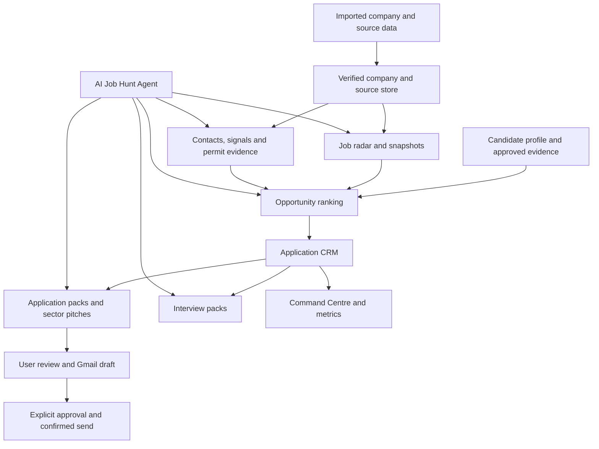

# Dublin Tech Compass Version 4 Architecture

## Goal

Version 4 extends the private Dublin Tech Compass into an owner-scoped interview-generation workbench. Existing companies, source rows, enrichment, AI research, Gmail connection and sector navigation remain the source system for the new workflows.

## System flow

## Trust boundaries

- All new routes require the authenticated Sites user and owner-scoped queries.
- Uploaded CVs and generated files remain private R2 objects; only metadata and carefully scoped derived data enter D1.
- External pages, job descriptions and model output are untrusted data. Server-side schemas and approval gates decide what may be written or sent.
- Gmail send is a separate approval boundary. A draft is never treated as sent without a provider-confirmed message ID.
- Permit labels are evidence states, not legal conclusions. Every rule evaluation stores its source and effective date.

## Persistence units

The existing company/job/contact/source tables remain authoritative. Version 4 adds candidate profiles, evidence, job snapshots/discovery runs, matches, signals, recruitment contacts, applications/events, outreach drafts/events, interviews/packs, action items, daily metrics, notification preferences, activity audit, agent runs/steps and settings versions. Each table carries `owner_id`, stable IDs and timestamps; uniqueness constraints are scoped to the owner.

## Execution policy

Each phase follows: checklist update, failing test, minimal implementation, focused test, full regression test, evidence capture and commit. Production migration is additive and executed only through a short-lived, server-only migration control after staging evidence is available.
